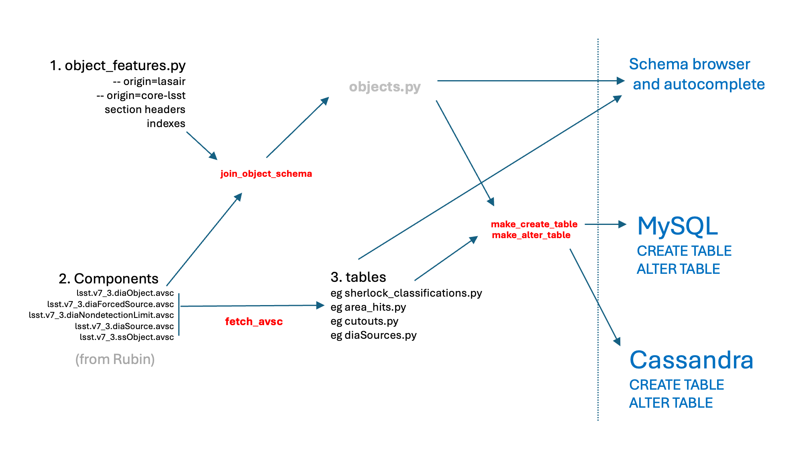

## Lasair Schema handling



New plan for schema wrangling, which should take out a lot of the manual intervention that we have now whenever the Rubin schema gets updated. In the diagram, there is a flow from left to right. 

Top-left is the Lasair `object_features` schema, listing the Lasair-specific light-curve and other features, with docstrings, together with the section headers for presentation, and the index to be used for the MySQL `objects` table.

Lower left is the five AVSC files from the [Rubin schema](https://github.com/lsst/alert_packet/tree/main/python/lsst/alert/packet/schema/7/3). These are liable to be changed without our control. They are named as for example 7.4 or 704 which mean the same thing.

The box in the centre of the diagram is a versioned collection of all the Lasair schemas. In addition to `objects.py`, there are MySQL schemas for `sherlock_classifications`, `area_hits`, and others, and there are CQL schemas for `diaObjects`, `diaSources`, `cutouts`,  etc.

The box in the diagram indicates that these files are versioned.
We are using a naming scheme like 7_4 or 7_4_a, where the first two 
parts of the name -- 7 and 4 -- are used to refer to the associated Rubin schema, 
and the last part of the name is a possible new version of the schema 
tables from Lasair, for example adding a new lightcurve feature at the top-left.

Indexing information is held in three places: for the Rubin components the index is stored in and added by the `1_fetch_avsc` program; for the Lasair `objects` table it is in the `object_features` table top-left; and for other tables it is kept in the versioned schema files.

These data files are transformed by three programs:

- `1_fetch_avsc`: pulls the AVSC files from github, and makes some cosmetic changes. Also changes dec to decl and adds the indexes needed to store these in Cassandra.

- `2_join_object_schema`: combines Lasair `object_features` and the Rubin `diaObject` above and builds the `objects.py` in the relevant schema directory.

- `3_make_create_table`: converts the table specifications to SQL or CQL CREATE TABLE commands, or

- `3_make_alter_table`: compares the table specifications of two different schema instantiations and uses the difference to make SQL or CQL ALTER TABLE commands. For MySQL it diffs the `indexes` as well as the fields. A named `KEY` or `UNIQUE KEY` whose columns changed is dropped and re-added in one `ALTER TABLE` statement, because MySQL auto-commits each DDL statement and the table must never sit unconstrained in between. Adding or changing a `UNIQUE` index also prints the `SELECT ... GROUP BY ... HAVING` to run first, since the statement fails outright if the live data already holds duplicates. It does not touch the `PRIMARY KEY`, which has no name to drop by; a change there, or any clause it cannot parse, is reported as a `-- CHECK BY HAND` comment ahead of the statements for you to act on.

There is also a `3_make_all_alter_table` which runs `3_make_alter_table` for all the tables.

### Updating the schema code
This is done on the lasair-lsst-dev cluster

- `cd lasair-lsst/common/schema`
- Copy the old to the new schema:
```
cp -R 7_3 7_4
```
- Fetch and replace all the Rubin .avsc files:
```
python3 1_fetch_avsc.py 7_4
```
- For a minor schema change, only the `diaSources` schema is changed, so you can skip this step. This updates `objects.py`, either because Rubin has changed the `disObject` schema,
or because Lasair has added attributes/features to the `objects` table.

  - Modify the `object_features.py` with the new attributes. The Galera schema has
of two parts: featured copied from the LSST 'diaObjects` schema, and added
value features made by Lasair. If the former, the new attribute has `"origin": "lsst"`
and if the latter it has `"origin": "lasair"`. In the latter case, there are checks made to ensure the code generates the attribute.

  - Build the combined `objects.py` for MySQL:
```
    python3 2_join_object_schema.py 7_4
```
- Generate required `ALTER TABLE` commands:
```
python3 3_make_all_alter_table.py 7_3 7_4
```
There will be ALTER TABLE commands for both Cassandra and MySQL. 
Keep a note of these, you will need them when deploying to production.

Finally, change the `SCHEMA_VERSION` in several places:
```
deploy/common/settings.py.j2
deploy/deploy.yaml
deploy/database.yaml
tests/system/system_test_settings.yaml
tests/unit/pipeline/filter/annotation/settings.py
```

Now push the code changes to git.

With the new code in place, we update the databases:

- Update the Cassandra nodes: `ssh lasair-lsst-dev-cassandranodes-0` then `cqlsh`
then `use lasair` then do the CQL ALTER TABLE commands.

- Update the filter nodes. For each one, start `mysql` then run the SQL ALTER TABLE commands.

- Update Galera, run the SQL ALTER TABLE commands

Now see if it all works. See the companion guide [Update Lasair System](https://lsst-uk.atlassian.net/wiki/spaces/LUSC/pages/5345312769/Update+Lasair+System)


